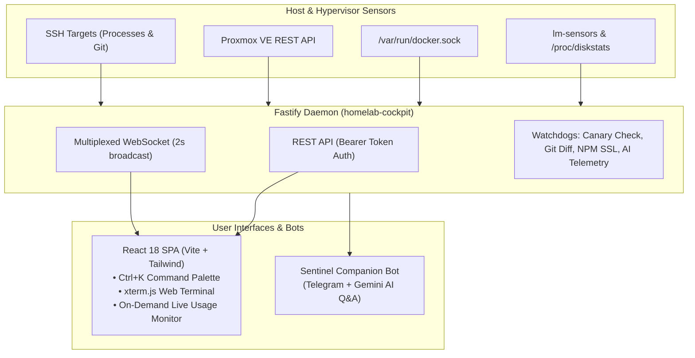

<a id="top"></a>

<div align="center">


# Homelab Dashboard

### Single-Pane Homelab Cockpit & Real-Time Observer

A lightweight, single-pane dashboard for compact homelabs: Proxmox VE host vitals, Docker container telemetry, Tailscale peers, storage & DAS mount health, SSL expiry, AI coding agent metrics, and an optional Telegram companion bot. One Node.js daemon, one React client, zero external monitoring bloat.

[](https://nodejs.org/)
[](https://fastify.dev/)
[](https://react.dev/)
[](https://www.typescriptlang.org/)
[](https://vitejs.dev/)
[](https://tailwindcss.com/)
[](https://www.docker.com/)
[](LICENSE)

[Quick Start](#quick-start) · [Architecture](#architecture) · [Key Features](#key-features) · [Redeployment](#out-of-process-redeployment) · [HTTP API](#http-api)

</div>

> Built for homelab owners who want complete visibility across host, containers, tunnels, and storage without burning gigabytes of RAM on heavyweight monitoring stacks.

---

## Results in Production

Running on an unprivileged Ubuntu 24.04 LXC on a Lenovo ThinkCentre M710q Tiny under Proxmox VE 8, replacing a stack of separate monitoring tools (Netdata, Uptime Kuma, Portainer, and Homelable):

| Metric | Before (Fragmented Stack) | After (Homelab Dashboard) | Impact |
| :--- | :--- | :--- | :--- |
| **Monitoring Containers** | 6 containers across 4 tools | **1 daemon container** (`homelab-cockpit`) | **-83.3%** container count |
| **LXC Memory in Use** | High baseline pressure | **~2.2 GB** of 12 GB allocated | **9.8 GB** headroom freed |
| **NVMe SSD Storage** | Bloated layers, cache & volumes | Cleaned via safe prune | **15.27 GB** reclaimed |
| **Browser Tabs Needed** | 4 separate tabs | **1 unified cockpit tab** | **-75%** context switching |
| **Telemetry Network Traffic** | 4 independent poll loops | **1 multiplexed WebSocket** (2s tick) | Zero polling storm |

*Read the full production benchmark and hardware breakdown in [docs/case-study.md](docs/case-study.md).*

---

## Architecture

Homelab Dashboard gathers metrics across local kernel interfaces, Proxmox VE hypervisor APIs, and remote SSH targets, feeding a single Fastify daemon that pushes updates over an authenticated 2-second WebSocket stream.



---

## Key Features

<table>
<tr>
<td width="50%" valign="top">

### 🖥️ Fleet & Host Telemetry

- **Host & Hypervisor Vitals**: Proxmox VE CPU, RAM, package thermals, fan speed, throttling counters, and vzdump backup status.
- **Container Fleet & Live Monitor**: Search, filter, and inspect containers. Includes an on-demand 5-minute auto-stopping live CPU/RAM monitor to minimize idle CPU cycles.
- **Multi-Docker Host Aggregation**: Aggregate multiple Docker daemons via `DOCKER_HOSTS` into a single searchable inventory.
- **Storage & DAS Watchdog**: Per-volume disk metrics with a canary file check (`.mounted`) on external enclosures to alert immediately if a drive disconnects.
- **5 Infra Operational Domains**: Dedicated sub-views for Overview, Network, Storage, Performance, and Backup.
- **Process Inspector**: Granular process inspection across primary host, container top processes (`docker top`), and remote nodes via read-only SSH.

</td>
<td width="50%" valign="top">

### ⚡ Operations, Deployment & Bot

- **Tailscale Mesh Peer Table**: Live peer presence, `100.x` Tailscale IPs, MagicDNS names, subnet routes, and exit node status.
- **SSL Certificate Tracker**: Proactive expiration countdown for Nginx Proxy Manager / Let's Encrypt certificates (30d and 14d alerts).
- **Disk Hygiene & Safe Prune**: Detect reclaimable dangling Docker layers and build cache with one-click safe pruning.
- **Git Projects Deployment**: Track source-built containers against GitHub repos, inspect commit diffs for migration risks, and trigger rebuilds.
- **Cloudflare Tunnel Manager**: Inspect remote tunnels, map domains to origins, and edit public hostnames and DNS records in one place.
- **AI Coding Agents Monitor**: Rolling 5-hour quota windows, cooldown timers, and weekly charts for Claude and Gemini/Antigravity.
- **Integrated Browser Terminal**: Interactive `xterm.js` terminal connecting to host nodes via configured SSH keys.
- **Sentinel Companion Bot**: Optional Telegram companion for mobile alerts and conversational Q&A via Google Gemini.

</td>
</tr>
</table>

---

## Tech Stack

| Layer | Technology |
| :--- | :--- |
| **Daemon & Server** | Node.js 20+ LTS, Fastify 5, TypeScript 5, `@fastify/websocket`, `ssh2` |
| **Client Frontend** | React 18, Vite 6, Tailwind CSS v3, Lucide React, `xterm.js` |
| **Containerization** | Docker, Docker Compose, Multi-stage alpine build |
| **Telemetry & Sensors** | Proxmox VE REST API, `/proc/diskstats`, `lm-sensors`, Docker Engine API |
| **Mesh & Network** | Tailscale Local API, Cloudflare API, Nginx Proxy Manager SQLite/MySQL |
| **AI Companion** | Google Gemini API (gemini-2.5-flash / gemini-1.5-pro), `node-telegram-bot-api` |

---

## Quick Start

### Prerequisites
- Node.js 20+ LTS (for local development)
- Docker Engine & Docker Compose v2

### Sequential Setup

```bash
# 1. Clone repository
git clone https://github.com/srytmj/homelab-dashboard.git
cd homelab-dashboard

# 2. Configure environment
cp .env.example .env

# 3. Install dependencies & build
npm install
docker compose up -d --build
```

The cockpit dashboard will be live at `http://<docker-host>:8050`.

> **Note:** Without a configured `.env`, the daemon starts in **demo mode** with simulated telemetry, perfect for UI preview and local development.

### Key Environment Checklist (`.env`)

- `STORAGE_MOUNTS`: Comma-separated paths on the daemon host (e.g., `/,/mnt/das`).
- `STORAGE_LABELS`: Optional human-readable labels matching `STORAGE_MOUNTS`.
- `DOCKER_SOCKET`: Path to Docker socket (default `/var/run/docker.sock`).
- `PROXMOX_URL`, `PROXMOX_TOKEN_ID`, `PROXMOX_TOKEN_SECRET`: PVE credentials for hypervisor metrics.
- `DOCKER_HOSTS`: Optional remote Docker endpoints for multi-host aggregation.
- `SSH_TARGETS`: Remote SSH host configs for process inspection and terminal sessions.

### Local Development Commands

```bash
npm run dev:server   # Start Fastify daemon with tsx watch on :3000
npm run dev:client   # Start Vite dev server on :5173
npm run build        # Build both client (Vite) and server (TypeScript)
npm start            # Run production Fastify server on :3000
```

---

## Out-of-Process Redeployment

Homelab Dashboard includes an out-of-process redeployment workflow via [`scripts/homelab-redeploy.sh`](scripts/homelab-redeploy.sh).

### Why Out-of-Process?
Executing `docker compose up -d --build` from *inside* the running container causes Docker to terminate the container process tree (`SIGTERM`). This aborts the rebuild mid-execution and cuts network feeds. The host script runs independently to ensure safe state transitions:
1. Stashes uncommitted tracked edits (`git stash push`).
2. Clears stale git index locks (`rm -f .git/index.lock`).
3. Fetches and syncs the target branch (`git reset --hard origin/<branch>`).
4. Rebuilds and recreates containers: `docker compose up -d --build --force-recreate`.
5. Logs progress to `data/redeploy.log` and updates `data/redeploy-status.json`.

### CLI Manual Execution
```bash
# Redeploy Homelab Dashboard itself
bash /root/homelab-redeploy.sh
# or from the repository root:
npm run redeploy

# Redeploy any tracked Git project (e.g., homelab-idp)
bash /root/homelab-redeploy.sh homelab-idp
```

### Background Watcher Daemon & Systemd
To allow Web UI one-click updates (**Update Sekarang** & **Pull & Redeploy**):

```bash
# Run watcher as a background daemon:
nohup /root/homelab-redeploy.sh --watch > data/redeploy-daemon.log 2>&1 &

# Or install as a systemd service (recommended):
sudo cp scripts/homelab-redeploy.service /etc/systemd/system/
sudo systemctl daemon-reload
sudo systemctl enable --now homelab-redeploy
```

*During self-redeploy, the React frontend displays a **"Service Restarting"** banner, polls `/api/health` every 1.5s, and seamlessly reconnects once the new container responds.*

---

## Troubleshooting

- **Container Terminated Mid-Redeploy**: If a rebuild was triggered inside the container instead of out-of-process, execute `bash scripts/homelab-redeploy.sh` directly on the host shell to clear stale locks and recover.
- **Proxmox Metrics Show `SIMULATED`**: Verify that `PROXMOX_URL` is reachable from the container, and that your API token has `PVEAuditor` permissions.
- **Emergency Access Reset**: If the owner token is lost, inspect or reset `data/auth.json` on the host volume, or check daemon startup output via `docker logs homelab-cockpit`.

---

## HTTP API

All endpoints except `/api/health` and `/api/auth/*` require authentication via `Authorization: Bearer <token>`. The WebSocket endpoint accepts the token via query parameter (`/ws?token=<token>`).

| Method | Path | Purpose |
| :--- | :--- | :--- |
| `GET` | `/api/health` | Liveness and health check |
| `GET` | `/api/auth/status` | Verify owner registration and token validity |
| `POST` | `/api/auth/register` | Initialize owner credentials (one-time setup) |
| `POST` | `/api/auth/login` | Authenticate and retrieve bearer token |
| `POST` | `/api/auth/logout` | Revoke active session token |
| `GET` | `/api/snapshot` | Full homelab telemetry snapshot |
| `GET` | `/api/tailscale` | Tailscale mesh status and peer details |
| `GET` | `/api/ssl` | SSL certificate expiration metadata |
| `GET` | `/api/sentinel` | Telegram companion bot status |
| `GET` | `/api/containers/:id/logs?tail=100` | Fetch container stdout/stderr logs |
| `POST` | `/api/containers/:id/restart` | Request container restart |
| `POST` | `/api/docker/prune` | Safe prune dangling images and build cache |
| `POST` | `/api/pins/:name` | Pin container with public tunnel domain |
| `DELETE` | `/api/pins/:name` | Remove container pin |
| `GET` | `/api/bookmarks` | Fetch customizable startpage bookmarks |
| `POST` | `/api/bookmarks` | Add new bookmark |
| `PUT` | `/api/bookmarks/reorder` | Reorder bookmarks array |
| `PUT` | `/api/bookmarks/:id` | Update bookmark details |
| `DELETE` | `/api/bookmarks/:id` | Delete bookmark |
| `POST` | `/api/git-projects/:name` | Register Git repository for container deployment |
| `DELETE` | `/api/git-projects/:name` | Unregister Git repository |
| `POST` | `/api/git-projects/:name/check-pull` | Dry-run git diff checking migration risks |
| `POST` | `/api/git-projects/:name/pull` | Pull upstream changes and rebuild container |
| `GET` | `/api/ai-agents/telemetry` | AI agent rolling token limits and usage stats |
| `GET` | `/api/app-update/status` | Compare local commit against remote upstream |
| `POST` | `/api/app-update/check` | Fetch upstream commit metadata |
| `POST` | `/api/app-update/update` | Trigger out-of-process self-update |
| `GET` | `/api/processes` | List host processes |
| `GET` | `/api/processes/docker` | List running container processes (`docker top`) |
| `GET` | `/api/processes/remote/:target` | Read-only process list on remote SSH target |
| `GET` | `/api/backup/status` | Rclone backup status, paths, and timestamps |
| `POST` | `/api/backup/run` | Trigger immediate cloud backup |
| `POST` | `/api/backup/restore` | Restore homelab data from remote target |
| `POST` | `/api/backup/import-config` | Import pins and git configs from URL |
| `GET` | `/api/ssh-targets` | List configured SSH targets |
| `WS` | `/ws` | Live multiplexed telemetry stream (every 2s) |
| `WS` | `/ws/terminal?target=<name>` | Interactive SSH web terminal stream |

---

## Known Limits & Backlog

- **Live Usage Monitor**: Live container CPU & RAM telemetry is gathered from the primary host Docker daemon; remote `DOCKER_HOSTS` report basic state.
- **SSH Web Terminal**: Requires pre-configured private keys on the host running the dashboard daemon.
- **Multi-Node Canary Checks**: Storage canary checks (`.mounted`) require the target directory to be locally mounted or shared with the dashboard container.

---

## Documentation Index

| Document | Purpose |
| :--- | :--- |
| [User Manual](docs/USER_MANUAL.md) | Comprehensive usage guide, settings reference, and keyboard shortcuts |
| [Design System](docs/DESIGN_SYSTEM.md) | Color palette, typography tokens, layout hierarchy, and UI guidelines |
| [Production Case Study](docs/case-study.md) | Real-world benchmark on Lenovo ThinkCentre M710q (Netdata/Kuma retirement) |
| [AI Agent Guidelines (CLAUDE.md)](CLAUDE.md) | Architectural briefings, code styles, and operational rules for agents |
| [Redeploy Script](scripts/homelab-redeploy.sh) | Out-of-process host updater and systemd service companion |

---

## License

This project is licensed under the [MIT License](LICENSE).

<div align="right"><a href="#top">Back to top ↑</a></div>
